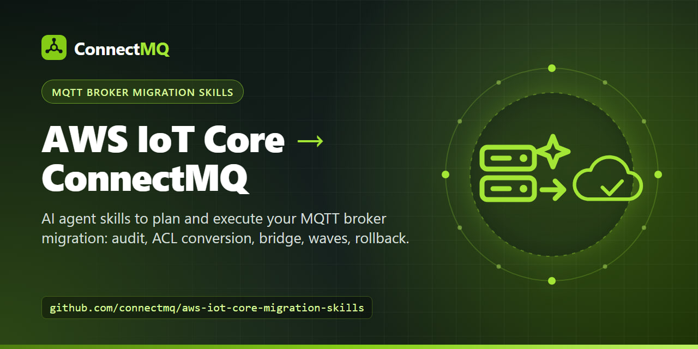

# AWS IoT Core Migration Skills for ConnectMQ

<p align="center"></p>

**AI agent skills for planning and executing a migration from AWS IoT Core to the [ConnectMQ](https://connectmq.com/?utm_source=github&utm_medium=readme&utm_campaign=migration-skills&utm_content=aws-iot-core) managed MQTT broker.**

Give your AI coding agent (Claude Code, Claude.ai, or any agent that reads `SKILL.md` skills) the knowledge and the
tools of an IoT migration engineer: it inventories things, IoT policies, topic rules and Device Shadows with the AWS
CLI, converts policies to ConnectMQ access control rules, redesigns `$aws/` topics, plans the firmware rollout, then
runs a relay between AWS IoT Core and ConnectMQ, copies shadow state and moves devices in waves with rollback.

> Part of the **MQTT Broker Migration Skills** collection:
> [HiveMQ](https://github.com/connectmq/hivemq-migration-skills) ·
> [Mosquitto](https://github.com/connectmq/mosquitto-migration-skills) ·
> [EMQX](https://github.com/connectmq/emqx-migration-skills) ·
> [VerneMQ](https://github.com/connectmq/vernemq-migration-skills) ·
> **AWS IoT Core** ·
> [Azure IoT Hub](https://github.com/connectmq/azure-iot-hub-migration-skills)

## What's inside

| Skill | What it does |
| --- | --- |
| [`aws-iot-core-migration-planner`](skills/aws-iot-core-migration-planner/SKILL.md) | AWS CLI inventory (things, policies, rules, shadows, Jobs), CloudWatch sizing, fit check against ConnectMQ plans, policy-to-ACL conversion, `$aws/` topic redesign, replacements for the rules engine and shadows, two-step firmware plan; writes `migration/plan.md` |
| [`aws-iot-core-migration-executor`](skills/aws-iot-core-migration-executor/SKILL.md) | Verifies ConnectMQ, creates a least-privilege relay thing, runs the relay, copies shadows to retained topics, validates both sides, moves thing groups in waves (OTA or AWS IoT Jobs), rolls back, deactivates certificates and rules; keeps `migration/log.md` |

### Scripts (Python 3.9+)

| Script | Purpose |
| --- | --- |
| `aws_policy_to_connectmq.py` | IoT policy JSON -> ConnectMQ ACL rules: Allow/Deny, `iot:Publish/Subscribe/Receive/Connect`, `${iot:ClientId}` / thing-name variables, policy wildcards, `$aws/` topic remapping (standard library only) |
| `aws_shadows_to_retained.py` | Classic and named Device Shadows (files or `--fetch` via AWS CLI) -> retained `things/<thing>/shadow/{reported,desired}` messages |
| `client_id_map.py` | Thing names -> `<ISSUED_ID>_<thing>`, flags unsafe characters and collisions |
| `verify_connectmq.py` | Smoke test: TLS connect, QoS 0/1/2, retained, Last Will, persistent session, ACL denies |
| `relay.py` | AWS IoT Core (X.509 client certificate) <-> ConnectMQ relay with loop protection |
| `copy_retained.py` | Publishes the shadow import file (or copies retained messages) to ConnectMQ |
| `compare_streams.py` | Subscribes on both sides and compares topics, counts and payloads |

MQTT scripts need `pip install "paho-mqtt>=2.0"`. Nothing here calls AWS unless you run the inventory commands or
`aws_shadows_to_retained.py --fetch`, both with your own AWS CLI credentials.

## Install

### Claude Code (plugin)

```text
/plugin marketplace add connectmq/aws-iot-core-migration-skills
/plugin install aws-iot-core-migration-skills@connectmq-aws-iot-core-migration
```

### Claude Code (manual)

```bash
git clone https://github.com/connectmq/aws-iot-core-migration-skills
cp -r aws-iot-core-migration-skills/skills/* ~/.claude/skills/
```

Use `.claude/skills/` instead to install for one project only.

### Claude.ai

Zip a skill folder (e.g. `skills/aws-iot-core-migration-planner`) and upload it under Settings > Capabilities > Skills.

### Other agents

Each skill is a self-contained folder with a `SKILL.md` (YAML front matter + instructions), `references/` and
`scripts/`. Agents that support the Agent Skills format can load the folders directly.

## Example prompts

- "We have 600 ESP32 devices on AWS IoT Core with X.509 certificates. Plan a move to ConnectMQ."
- "Convert these IoT policies to ConnectMQ access control rules."
- "What replaces our topic rules that write to DynamoDB and Timestream?"
- "Copy all Device Shadows into retained topics on ConnectMQ."
- "Set up a relay between AWS IoT Core and ConnectMQ for dt/# and cmd/#."
- "Devices fail the TLS handshake after switching to ConnectMQ. What is wrong?"

## How the migration works

1. **Plan**: inventory AWS IoT, measure with CloudWatch, check plan limits, redesign `$aws/` topics, convert
   policies, give every topic rule a replacement owner.
2. **Firmware step 1**: while devices are still on AWS, add the ConnectMQ root CA and storage for credentials.
3. **Relay**: a dedicated relay thing forwards device traffic to ConnectMQ and commands back to AWS.
4. **Backends first**: rule replacements and apps consume from ConnectMQ in shadow mode.
5. **Firmware step 2 in waves**: thing groups switch endpoint, credentials, client ID and topics; AWS certificates
   stay active as the rollback lever.
6. **Decommission**: disable rules, deactivate then delete certificates after the rollback window.

Key ConnectMQ facts the skills plan around: credentials are generated in the console and come with an issued client
ID (devices connect as `<ISSUED_ID>_<thing>`), authentication is username/password over TLS (no X.509 client
certificates), there is no shadow, rules-engine or jobs service (retained topics and small backends replace them),
per-topic ACL and shared subscriptions are on Basic and Scale, and each plan caps connections, session minutes,
connection rate, message size, retained messages and session expiry. See
[plans and limits](https://github.com/connectmq/connectmq/wiki/Plans-and-Limits).

## Repository layout

```
.claude-plugin/              plugin + marketplace manifests (Claude Code)
skills/
  aws-iot-core-migration-planner/
    SKILL.md
    references/              connectmq-target.md, aws-iot-core-mapping.md, cutover-and-rollback.md
    assets/                  migration-plan-template.md
    scripts/                 aws_policy_to_connectmq.py, client_id_map.py, connectmq_acl.py
  aws-iot-core-migration-executor/
    SKILL.md
    references/              connectmq-target.md, aws-iot-core-bridge.md, cutover-and-rollback.md
    scripts/                 relay.py, aws_shadows_to_retained.py, copy_retained.py, verify_connectmq.py, ...
```

## Learn more

- Blog: [AWS IoT Core Migration Skills: Move from AWS IoT Core to ConnectMQ with an AI Agent](https://connectmq.com/blog/aws-iot-core-migration-skills/?utm_source=github&utm_medium=readme&utm_campaign=migration-skills&utm_content=aws-iot-core)
- [ConnectMQ docs (wiki)](https://github.com/connectmq/connectmq/wiki) · [MQTT code samples](https://github.com/connectmq/mqtt-code-samples)
- Start free (no credit card): [app.connectmq.com/signup](https://app.connectmq.com/signup?utm_source=github&utm_medium=readme&utm_campaign=migration-skills&utm_content=aws-iot-core)

## Contributing

Issues and pull requests are welcome: AWS IoT features the skills do not cover yet, policy constructs the converter
misses, fixes to the scripts. Please do not include real certificates, account IDs, endpoints or customer data.

## License

MIT. AWS and AWS IoT Core are trademarks of Amazon.com, Inc. or its affiliates; this project is not affiliated with
or endorsed by Amazon Web Services.
